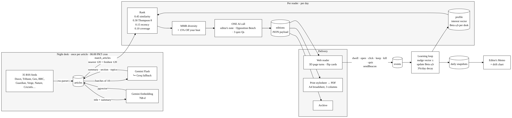

# The Brief.

**One newspaper, made for one reader, every morning.**

The Brief reads ~35 news desks overnight, from Dawn and Geo to the BBC, Nature and ESPNcricinfo, and prints a single personal paper, laid out like a real broadsheet and sized to the minutes you have. Read it on the web, turn its pages, flip any story to see why it's there, keep or kill it with a blue pencil, or download the whole edition as a PDF. Every mark you make changes tomorrow's paper.

**Live:** https://the-brief-vert.vercel.app

Built for NaSCon '26 AI Hackathon.

## What makes it different

* **Why this story?** Every story flips over to show why it was chosen, in plain words.
* **Blue pencil.** Keep or kill from the back of the card. Killed stories are struck through and fold out of the paper.
* **The Opposition Bench.** The lead story argued both ways, as a formal motion.
* **Three things you now know.** The back page quizzes you on what you read, because the brief was that readers "can't name three things they learned".
* **Off your beat.** A few stories each day from desks you never read, so the paper can't shrink into a bubble.
* **Editor's Memo.** The paper tells you what it learned about you, and you can overrule it by rewriting your profile in your own words.
* **Summarise once, personalise cheaply.** Each article hits the AI once, ever; each paper is vector maths plus one AI call. All on free tiers.



See [docs/ARCHITECTURE.md](docs/ARCHITECTURE.md) for the ranking formula and learning loop.

## Run it

Requires Node 20+.

```bash
npm install
cp .env.example .env.local      # then fill in the keys (see below)
npm run db:setup                # creates tables, pgvector, search function
npm run ingest                  # pulls feeds and files them with AI (2–4 min first time)
npm run dev                     # http://localhost:3000
```

1. Sign up, answer one question, mark a few headlines, pick your minutes.
2. Your first paper prints.
3. Optional, for demos: `npm run seed:demo -- you@example.com` replays a week of reading so the profile and memo show real learning.

### Keys (all free)

| Variable | Where |
|---|---|
| `GEMINI_API_KEY` | aistudio.google.com/apikey |
| `GROQ_API_KEY` | console.groq.com/keys |
| `NEXT_PUBLIC_SUPABASE_URL`, `NEXT_PUBLIC_SUPABASE_ANON_KEY`, `SUPABASE_SERVICE_ROLE_KEY` | Supabase → Project Settings → API |
| `DATABASE_URL` | Supabase → Connect → Session pooler |
| `CRON_SECRET` | any long random string |

In Supabase → Authentication → Sign In / Providers → Email, turn **off** "Confirm email".

### Deploy

Import the repo on Vercel, add the same environment variables, deploy. `vercel.json` schedules `/api/ingest` daily at 06:00 PKT.

## Stack

Next.js 15 · TypeScript · Tailwind v4 · Motion · Supabase (Postgres, pgvector, Auth) · Gemini Flash + Groq (free tiers) · Gemini embeddings · rss-parser · Zod · Vercel.

Type: Newsreader (Production Type), Libre Franklin, UnifrakturMaguntia, all open-source and self-hosted.
