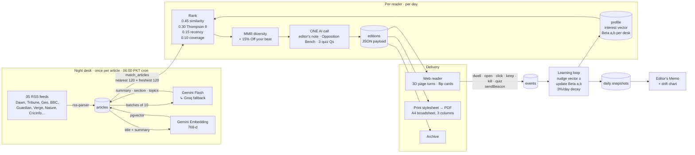

# Architecture

**Summarise once, personalise cheaply.** Every article is processed by AI exactly once, no matter how many readers there are. Building one reader's paper is vector maths plus **one** AI call.



## Components

| Layer | Choice | Why |
|---|---|---|
| App | Next.js 15 (App Router), TypeScript | Web reader, onboarding and API in one deploy |
| Styling | Tailwind v4, no component kit | Every element designed for this paper |
| Motion | `motion` + CSS 3D transforms | Page turns, flip cards, kill-fold. No WebGL needed |
| Database | Supabase Postgres + pgvector | Relational data and vectors in one place |
| Auth | Supabase Auth (email + password) | RLS denies all browser access; server uses the service role after verifying the user |
| Ingest | `rss-parser`, 35 feeds | Free, no keys, no rate limits |
| AI | Gemini Flash (free tier) → Groq `gpt-oss-120b` (free tier) | Automatic failover. Every response validated with Zod |
| Embeddings | Gemini embedding, 768 dims, Matryoshka-truncated | Free; cosine = dot product after normalising |
| PDF | Print stylesheet (`@page`, CSS columns) from the same edition JSON | Web and PDF can never drift apart |
| Hosting | Vercel (Hobby) + Vercel Cron | Free |

## The ranking, precisely

For each candidate article *i* and reader *u*:

```
score_i = 0.45 · norm(cos(v_u, e_i))      semantic match
        + 0.30 · θ_s,  θ_s ~ Beta(a_s, b_s) Thompson sample for section s
        + 0.15 · exp(−age_h / 18)          recency
        + 0.10 · min(coverage_i, 4) / 4     outlets carrying the same story (cos > 0.86)
```

Then **MMR** (λ = 0.72) picks the set: `λ·score − (1−λ)·max_sim_to_already_chosen`, skipping near-duplicates (cos > 0.9) and capping any one desk at a third of the paper. About 15% of slots are **Off your beat**: the highest-coverage stories from desks the reader rarely sees.

Thompson sampling is the exploration engine: a desk with little evidence has a wide Beta distribution, so it sometimes samples high and gets tested. A desk the reader keeps killing narrows toward zero and disappears.

Layout follows confidence: the top story leads, the next two are majors, weak-affinity desks are set as briefs, and a 5-minute reader gets briefs after the first four.

## The learning loop

| Signal | How captured | Desk Beta update | Vector nudge |
|---|---|---|---|
| Keep | Back of card | a += 1.5 | +0.20 |
| Kill | Back of card | b += 1.5 | −0.15 |
| Click to source | Headline link | a += 0.7 | +0.10 |
| Flip ("Why this story?") | Card | a += 0.4 | +0.05 |
| Dwell ≥ 4s | IntersectionObserver, ≥ 60% visible | a += min(sec/30, 1) | +0.06·w |
| Quiz right | Back page | a += 0.3 | +0.03 |
| Rewrite profile | Profile page | — | +0.6 toward new text embedding |

Evidence decays 3% per day toward the prior, so the paper follows who you are now. Daily snapshots power the drift bars and the Editor's Memo.

## Cost per reader per day

* Ingest: ~1 AI call per 10 articles, shared by **all** readers.
* Paper: 1 AI call per reader (~2–3k tokens).
* Everything runs inside free tiers.
